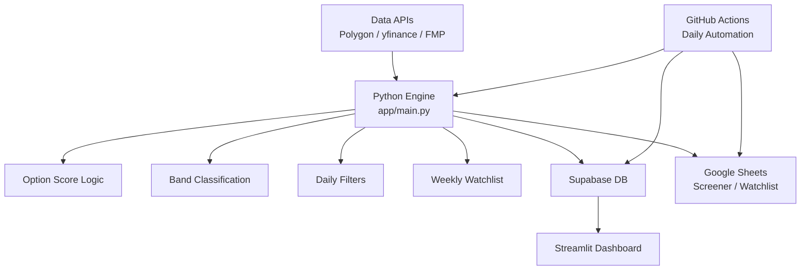
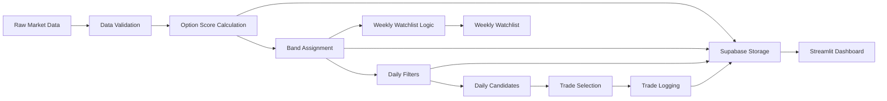

# Alpha_Business_Logic.md
### Complete Business Logic Specification for the Alpha Option Trading System  
### Includes Mermaid Architecture & Logic Diagrams

---

# 0. Mermaid System Architecture Diagram



---

# 1. Overview

Alpha is a fully automated, rules‑driven option trading system that:

- Scores tickers  
- Classifies risk  
- Filters daily candidates  
- Builds weekly watchlists  
- Generates strategy tags  
- Selects trades  
- Logs trades  
- Stores historical data  
- Visualizes everything in Streamlit  
- Automates daily updates via GitHub Actions  

This document defines the business logic layer — the rules and decisions that govern Alpha.

---

# 2. Data Ingestion Logic

Alpha ingests market, options, and fundamentals data from:

- Polygon (options chain, OI, bid/ask)  
- yfinance (IV, HV, earnings, price)  
- FMP (fundamentals)  

### Required Fields

```
Price
Avg Volume (Shares)
Option Volume
Max OI (Near Exp)
Bid-Ask Spread %
IV 30d
IV Rank (1y)
HV 30d
ATR
Trend (20/50/200 EMA)
Next Earnings Date
Short Interest %
Sector
Revenue Growth (YoY)
Debt/Equity
Quality Score (1–5)
```

### Business Rules

- All numeric fields must be validated and coerced to numeric.  
- Earnings date must be parsed into a real date.  
- Missing values → excluded from scoring.  
- Data stored daily in Supabase (`daily_metrics`).

---

# 3. Option Score Logic (0–9)

Alpha computes a 9‑point score based on liquidity, volatility, fundamentals, and risk.

### Scoring Rules

| Condition | Points |
|----------|--------|
| Option Volume > 2000 | +1 |
| Max OI > 500 | +1 |
| Bid‑Ask Spread < 8% | +1 |
| IV 30d > 0.25 | +1 |
| IV Rank ≥ 40 | +1 |
| ATR/Price < 4% | +1 |
| Earnings > 14 days away | +1 |
| Short Interest < 15% | +1 |
| Quality Score ≥ 3 | +1 |

### Purpose
Higher score = safer, more liquid, more predictable underlying.

---

# 4. Band Classification Logic (A–E)

| Band | Score | Meaning |
|------|--------|---------|
| A | 8–9 | Safest, most liquid, best for premium selling |
| B | 6–7 | Good candidates, stable |
| C | 4–5 | Medium risk |
| D | 2–3 | High risk |
| E | 0–1 | Avoid |

### Purpose
- Band A/B → weekly watchlist  
- Band C → conditional trades  
- Band D/E → excluded from selling premium  

---

# 5. Daily Filter Logic

Daily candidates must pass all filters:

### Liquidity Filters
- Option Volume ≥ 2000  
- Max OI ≥ 500  
- Bid‑Ask Spread ≤ 8%  

### Risk Filters
- Earnings > 14 days away  
- Short Interest < 15%  

---

# 6. Volatility Logic

### Volatility Bias
```
IV Rank ≥ 50 → Sell premium
IV Rank ≤ 30 → Buy premium
Else → Neutral
```

### IV vs HV Logic
```
IV > HV → Options expensive → Selling better
IV < HV → Options cheap → Buying better
IV ≈ HV → Neutral
```

---

# 7. Trend Logic (20/50/200 EMA)

Trend categories:

```
Bullish → Price above 20, 50, 200 EMA
Bearish → Price below 20, 50, 200 EMA
Range → Mixed signals
```

---

# 8. Weekly Watchlist Logic

### Inclusion Rules
- Option Score ≥ 6  
- Earnings > 14 days  
- Band A/B preferred  
- Trend + Volatility must align  

### Strategy Tag Logic

| IV Rank | Trend | Strategy |
|--------|--------|----------|
| ≥ 50 | Bullish | Short Put / Bull Put Spread |
| ≥ 50 | Bearish | Bear Call Spread / Iron Condor |
| ≥ 50 | Range | Iron Condor / Short Strangle |
| ≤ 30 | Bullish | Call Debit Spread / Calendar |
| ≤ 30 | Bearish | Put Debit Spread / Calendar |
| ≤ 30 | Range | Straddle / Strangle |
| 30–50 | Range | Iron Condor / Butterfly |
| 30–50 | Trend | Directional Spread |

---

# 9. Trade Selection Logic

### Trade Selection Rules
- Choose 1–3 trades per day  
- Only from Daily Candidates  
- Prefer Band A/B  
- Avoid tickers with:
  - News  
  - Earnings  
  - High ATR  
  - High Short Interest  

### Trade Entry Requirements
- Spread width appropriate  
- Credit/debit meets minimum threshold  
- Probability of profit acceptable  
- Risk/reward balanced  

---

# 10. Trade Logging Logic

Each trade must include:

```
Date
Ticker
Strategy
Entry strikes
Expiry
Credit/debit
Reason (IV Rank, trend, earnings distance)
Exit plan (profit target, max loss, time stop)
```

---

# 11. Supabase Backend Logic

| Table | Purpose |
|-------|---------|
| daily_metrics | Raw daily data |
| option_scores | Score history |
| bands | Band history |
| signals | Buy/sell premium signals |
| trades | Trade log |
| audit_log | System events |

---

# 12. Streamlit Dashboard Logic

Streamlit displays:

- Screener  
- Bands  
- IV vs HV charts  
- Trend charts  
- Trade log  
- P&L curves  
- Weekly Watchlist  

---

# 13. Automation Logic (GitHub Actions)

Runs daily at 8:30 AM ET:

1. Pull fresh data  
2. Compute scores  
3. Compute bands  
4. Apply filters  
5. Update Supabase  
6. Update Sheets  
7. Refresh Streamlit  

---

# 14. Mermaid Business Logic Flow Diagram



---

# Final Summary

Alpha is a rules‑driven, automated option trading system that:

- Scores tickers  
- Classifies risk  
- Filters daily candidates  
- Builds weekly watchlists  
- Selects trades  
- Logs trades  
- Stores history  
- Visualizes everything  
- Automates daily updates  

This file is the complete business logic layer powering the entire Alpha platform.